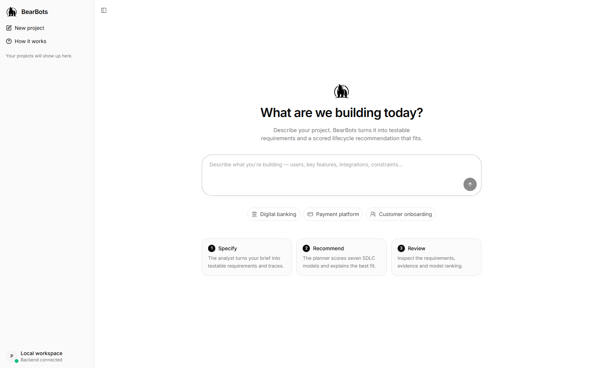
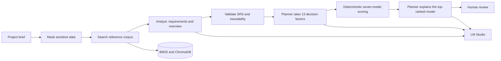

<div align="center">

# BearBots

**Turn a project brief into testable software requirements and an explainable development lifecycle recommendation.**

[](https://www.python.org/)
[](https://react.dev/)
[](https://www.typescriptlang.org/)
[](https://fastapi.tiangolo.com/)
[](#run-bearbots-locally)

</div>

<p align="center">
  
</p>

## What BearBots does

BearBots helps turn an early project idea into a reviewable software requirements specification (SRS) and a data-backed SDLC recommendation. Its Analyst drafts requirements from the project brief and reference library. Its SDLC Planner rates decision factors and explains the highest-scoring model.

The flow runs automatically: **brief → SRS → SDLC recommendation → human review**. The generated documents are drafts; a qualified person should review regulatory interpretations and project decisions before implementation.

## Features

- **Testable requirements:** creates 8–10 functional and non-functional requirements with priorities, measurable acceptance criteria, source references and test traceability.
- **Quality checks:** renumbers requirements, flags duplicates and vague or missing acceptance criteria, and identifies unsupported citations for review.
- **Seven-model ranking:** scores Waterfall, V-Model, Spiral, Prototyping, Iterative, Agile and RAD using fixed decision weights.
- **Readable model explanations:** the Planner writes a short justification for the selected model. Select any model in the ranking to see why it was chosen or passed over.
- **Reference search:** combines BM25 keyword matching with ChromaDB vector search across the included finance, security and requirements corpus.
- **Local processing:** sends model requests to LM Studio on the same computer. BearBots masks PAN, Aadhaar, card numbers, email addresses and phone numbers before sending brief text to the model.
- **Run trace:** records model calls, retrievals, timing and token counts in the app’s activity panel. Backend events are also appended to `backend/runs/` as JSON Lines files.

## How it works



### SDLC scoring

The Planner rates 13 factors as Low, Medium or High. `backend/rules.py` applies fixed weights to those ratings, sorts all seven models and returns each model’s base score, factor contributions, score, fit and drawback. The Planner explains the top-ranked result; it does not change the deterministic ranking or generate a project workflow.

## Technology

| Area | Technology |
|---|---|
| Frontend | React, TypeScript, Vite and Tailwind CSS |
| API | FastAPI and Python |
| Agent orchestration | Google ADK and LiteLLM |
| Local inference | LM Studio with `qwen/qwen3-4b` |
| Retrieval | BM25 and ChromaDB with `text-embedding-nomic-embed-text-v1.5` |

## Run BearBots locally

### Prerequisites

- Python 3.12 and [uv](https://docs.astral.sh/uv/)
- Node.js and npm
- [LM Studio](https://lmstudio.ai/) with `qwen/qwen3-4b` and `text-embedding-nomic-embed-text-v1.5` available

### 1. Start LM Studio

In a terminal where the LM Studio CLI (`lms`) is available:

```powershell
lms server start
lms load qwen/qwen3-4b
lms load text-embedding-nomic-embed-text-v1.5
```

### 2. Start the backend

In PowerShell:

```powershell
cd backend
uv venv --python 3.12 .venv
uv pip install --python .venv\Scripts\python.exe -r requirements.txt
.venv\Scripts\python.exe -m uvicorn server:app --host 127.0.0.1 --port 8000
```

### 3. Start the frontend

Open another terminal:

```powershell
cd frontend
npm install
npm run dev
```

Open the Vite URL shown in the terminal, usually [http://127.0.0.1:5173/](http://127.0.0.1:5173/). The frontend proxies `/api` requests to the backend on port 8000.

Optional model settings are in `backend/.env.example`. Copy it to `backend/.env` to change `LM_STUDIO_BASE_URL`, `LM_STUDIO_MODEL` or `EMBED_MODEL`; keep `.env` private. The first vector search may take time while the corpus is indexed in `backend/chroma/`.

## API

| Endpoint | Purpose |
|---|---|
| `POST /api/sessions` with `{"brief": "..."}` | Start a run and return its session ID. |
| `GET /api/sessions/{id}/events` | Stream progress and generated documents using server-sent events. |
| `GET /api/sessions/{id}` | Check whether a session is still available. |
| `POST /api/sessions/{id}/reply` with `{"text": "..."}` | Acknowledge a message while the run is active or after it finishes. |
| `GET /api/health` | Return corpus size and configured model. |

## Project structure

```text
backend/
  agents.py                  Analyst and SDLC Planner schemas and prompts
  server.py                  API and brief-to-review pipeline
  rules.py                   Masking, retrieval, validation and scoring
  corpus/                    Finance, security and requirements references
frontend/
  src/                       BearBots React application
docs/images/
  bearbots-app.png           Application screenshot used above
```
